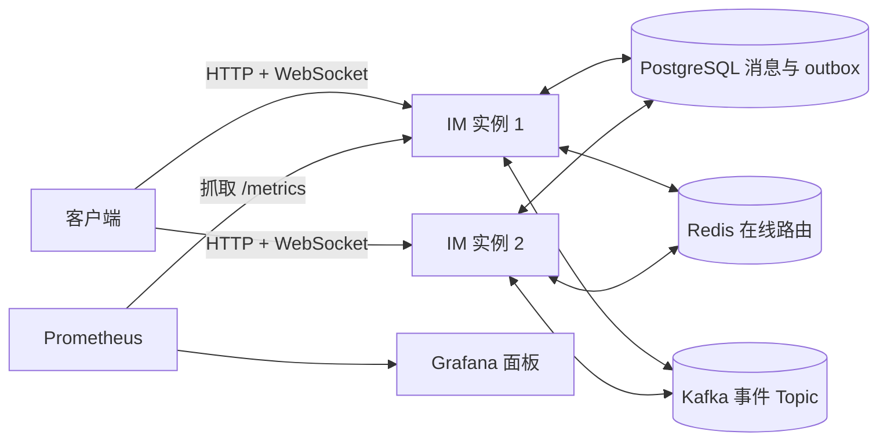

# Go 即时通信系统 · V1.0 迭代中

本项目按阶段构建可解释、可验证的即时通信系统。已实现注册、登录、JWT、WebSocket 单聊、PostgreSQL 落库、历史查询、客户端消息 ID 幂等、送达 ACK、未确认消息重试、离线补发与基础百人群聊。Redis 在线实例路由、Kafka outbox 跨实例事件代码和 Prometheus 指标端点已接入；真实 Kafka Broker 和监控容器环境尚未验证。双进程数据库补发路径已实测。**本机回环地址的负载测试已经执行，结果见 [BENCHMARK.md](BENCHMARK.md)，不是线上容量承诺。** [架构设计](ARCHITECTURE.md)、[学习记录](LEARNING.md)、[故障测试](FAILURE_TEST.md)与 [50 道面试题](INTERVIEW.md)记录实现依据和边界。

## 技术栈与架构

Go、HTTP REST、WebSocket、PostgreSQL、Redis、Kafka、Docker Compose、Prometheus、Grafana。数据库保存消息与 outbox 作为可靠状态；Redis 只保存可过期路由；Kafka 用于配置后的跨实例事件通知。下图是已编写代码与 Compose 对应的架构，**真实 Kafka/Redis 容器链路仍待验证**。



## 环境与启动

- Go 1.26+（本项目使用 Go Modules）
- Docker 与 Docker Compose

在仓库根目录运行：

```powershell
pwsh -File scripts/init-env.ps1
pwsh -File scripts/verify-compose.ps1
```

`init-env.ps1` 生成随机开发密钥；已有 `.env` 时只补缺失的 Grafana 密码。该文件已被 Git 忽略。PostgreSQL 数据保存在 Compose volume 中。迁移容器先执行 `migrations/*.sql`，成功后应用才启动；不要手动修改生产表结构。停止服务用 `docker compose --env-file .env -f deployments/compose.yaml down`，此命令保留数据卷。

若 5432/8080 已被占用，需调整 Compose 端口映射；若改动数据库密码但复用旧 volume，旧数据库密码不会自动变化。测试环境可先明确备份后清理 volume 再初始化。

`verify-compose.ps1` 会检查 Compose 配置、启动服务、等待 HTTP/指标/Prometheus/Grafana 就绪并核查 Kafka Topic；加 `-Multi` 会启用第二个 IM 实例。脚本不会删除数据卷。本机没有 Docker，脚本只做了 PowerShell 语法检查，运行步骤仍待有 Docker 的环境实测。

## 接口快速体验

```powershell
$alice = Invoke-RestMethod -Method Post http://localhost:8080/v1/auth/register -ContentType 'application/json' -Body '{"username":"alice","password":"password123"}'
$bob = Invoke-RestMethod -Method Post http://localhost:8080/v1/auth/register -ContentType 'application/json' -Body '{"username":"bob","password":"password123"}'
$login = Invoke-RestMethod -Method Post http://localhost:8080/v1/auth/login -ContentType 'application/json' -Body '{"username":"alice","password":"password123"}'
Invoke-RestMethod -Headers @{Authorization="Bearer $($login.token)"} "http://localhost:8080/v1/messages?peer_id=$($bob.user.id)"
```

WebSocket 地址是 `ws://localhost:8080/v1/ws`。升级后首帧发送 `{"type":"auth","token":"登录返回的 JWT"}`，收到 `auth.ok` 才发送 `{"type":"message.send","recipient_id":2,"client_message_id":"0c0dcce8-7a12-4f9d-8827-0527722092b1","body":"你好"}`。客户端对同一条逻辑消息的重试必须复用相同 UUID。完整协议和错误格式见 [ARCHITECTURE.md](ARCHITECTURE.md)。本地可用 `wscat` 或下面的端到端测试自动连接两个用户。

传入 `client_message_id` 的发送者收到 `server_ack`，它只表示消息已落库；接收者收到 `message.new` 后发送 `{"type":"delivery.ack","message_id":7}`，数据库状态才进入 `delivered`。旧客户端不传 ID 时保留第一阶段的发送者 `message.new` 回显。离线或 ACK 丢失会使同一消息帧重现，客户端需按服务器消息 ID 去重。重试批量与边界见架构文档。

基础群聊通过 `POST /v1/groups` 建群，`POST /v1/groups/{id}/join` 加入；WebSocket 发送 `{"type":"group.send","group_id":3,"client_message_id":"UUID","body":"大家好"}`。群消息只入库一行，在线成员收到 `group.message.new`；群历史和成员操作见 [ARCHITECTURE.md](ARCHITECTURE.md)。V1.0 限制每群最多 100 人，离线群消息通过历史 API 查询，暂无逐成员群 ACK。

## 监控

Go 服务在 `GET /metrics` 暴露 Prometheus 指标；本地 Compose 配置 Prometheus `http://localhost:9090` 和 Grafana `http://localhost:3000`。Grafana 管理员密码由 `.env` 中的 `GRAFANA_ADMIN_PASSWORD` 提供，面板配置在 [im-overview.json](deployments/grafana/dashboards/im-overview.json)。当前抓取配置监控默认 `app` 实例；启用 `multi` profile 时，应在 [prometheus.yml](deployments/prometheus.yml) 增加 `app2:8080` 目标。Grafana 截图应在真实容器启动并产生测试流量后保存至 `docs/screenshots/`；仓库现在没有监控截图或预填面板数据。`/metrics` 应只在受信网络开放。

`PPROF_ADDR=127.0.0.1:6060` 可选开启独立回环端口的 CPU、Heap、Goroutine Profile。不要将此端口转发到公网；实际采样与热点见 [BENCHMARK.md](BENCHMARK.md)。

## 测试与数据库核查

```powershell
go test ./...
$env:INTEGRATION_BASE_URL='http://localhost:8080'
$env:DATABASE_URL='postgres://im:<.env 中的 POSTGRES_PASSWORD>@localhost:5432/im?sslmode=disable'
go test -v ./tests
docker compose --env-file .env -f deployments/compose.yaml exec postgres psql -U im -d im -c 'SELECT id, sender_id, recipient_id, body, created_at FROM messages ORDER BY id DESC LIMIT 10;'
```

`tests/e2e_test.go` 使用真实 HTTP、两个 WebSocket 连接和 PostgreSQL，验证双向消息、落库及历史查询。`INTEGRATION_SERVER_BINARY` 与 `INTEGRATION_JWT_SECRET` 还可启用双进程故障恢复测试。未设置所需环境变量时测试会明确跳过，不可将跳过写成通过。实际执行记录见 [TEST_RESULTS.md](TEST_RESULTS.md)。

真实 Kafka 双实例链路可在 Compose 启动后设置 `INTEGRATION_SECOND_BASE_URL=http://localhost:8081`，并提供两个服务共用的 `DATABASE_URL` 与 `INTEGRATION_BASE_URL`，执行 `go test -run TestRealKafkaCrossInstanceDeliveryAndStatus -v ./tests`。本机无 Docker，当前该测试只完成编写并在缺少环境变量时跳过。

独立压测工具：

```powershell
go build -o loadtest.exe ./cmd/loadtest
./loadtest.exe -base http://127.0.0.1:8080 -connections 100 -users 10 -rate 50 -duration 15s -output result.json
```

详细负载模型、原始结果、pprof 和优化前后实测见 [BENCHMARK.md](BENCHMARK.md)。压测会创建用户与数据库消息，请使用测试数据库。

## 目录

```text
cmd/server             入口、依赖装配、退出
cmd/loadtest           独立 WebSocket 压测工具
internal/auth          密码散列、JWT
internal/config        环境配置
internal/handler       HTTP 接口
internal/middleware    Bearer 鉴权
internal/ratelimit     进程内令牌桶
internal/migration     迁移执行器
internal/messaging     Kafka outbox 发布与消费
internal/metrics       Prometheus 指标与数据库查询追踪
internal/model         数据结构
internal/presence      Redis 在线实例路由
internal/repository    PostgreSQL SQL
internal/service       业务规则
internal/websocket     Hub、连接读写循环
migrations             已版本化的 SQL
deployments            Dockerfile、Compose
benchmarks/results     本机真实测试的原始 JSON 汇总
scripts                开发密钥初始化
tests                  真实服务端到端测试
```

## 已知边界

- Hub 只管理本实例连接；Kafka 每实例独立消费组传播消息事件。PostgreSQL 中的未确认消息可由在线重试循环和重连同步补发。双进程数据库补发路径已测试；真实 Kafka 与真实 Redis 跨实例路径仍未验证。
- 跨实例送达状态使用 PostgreSQL `delivery_status_outbox` 和 Kafka 事件通知发送者；已测真实数据库事务和模拟消费边界，真实 Broker 待验证。
- 已实现送达 ACK 和重试，但客户端仍需去重；旧客户端不传 ID 时重发仍可能重复写库。已读 ACK 尚未实现。
- JWT 在到期前不可主动吊销；生产环境需要 TLS/WSS、密钥管理与限流。
- `go.mod` 暂用 `github.com/example/go-im`，发布到你的 GitHub 仓库前应替换为实际仓库路径并更新 Go import。
- 历史查询分页按数据库消息 ID，而非全局严格时间顺序。

Kafka/outbox 代码可用 `KAFKA_BROKERS` 启用；未设置时沿用单实例即时投递。`docker compose --profile multi --env-file .env -f deployments/compose.yaml up --build -d` 配置第二个服务实例（8081）；本机没有 Docker，Compose 及真实 Broker **未验证**。每实例独立消费组使 Kafka 读取成本随实例数增加。群离线消息目前通过历史 API 查询，尚无逐成员 ACK。正式本机回环压测已执行，但真实 Redis、Kafka 和 Compose 启动尚未在本机验证。
