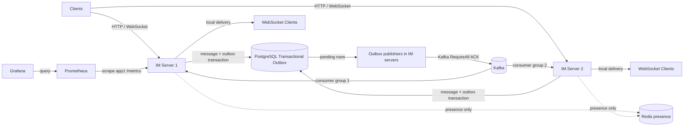

# Go Distributed IM System

技术栈：**Go · WebSocket · PostgreSQL · Redis · Kafka · Prometheus · Grafana · Docker Compose**。

这是一个用于学习与展示的 Go 即时通信项目。V1.0 已在本机完整 Docker Compose 环境验收；所有性能数字都来自该环境的真实测试，**不代表生产环境容量或系统最大吞吐**。[架构设计](ARCHITECTURE.md)、[学习记录](LEARNING.md)、[测试记录](TEST_RESULTS.md)、[性能调查](PERFORMANCE_INVESTIGATION.md)与[最终验收](FINAL_VALIDATION.md)保留实现依据和原始证据。

## 已实现功能

- HTTP 注册/登录、bcrypt 密码散列、JWT 鉴权、WebSocket 长连接、单聊与历史查询。
- PostgreSQL 持久化、客户端消息 UUID 幂等、接收方 ACK、未确认消息重试与离线补发。
- 双 IM 实例通过 PostgreSQL Transactional Outbox 和 Kafka 传播消息及送达状态；最多 32 条一批发布消息/状态 Outbox，Broker 确认后才标记已发布。
- 基础群聊（每群最多 100 人）、进程内限流、Redis 在线实例提示、Prometheus 指标与 Grafana 面板。

## 已真实验证能力

- 两台 IM Server、PostgreSQL、Redis、Kafka、Prometheus、Grafana 在本机 Docker Desktop Compose 中实际启动；跨实例消息与 ACK、真实 Broker 停机/恢复、Redis 停机降级均经过测试。
- 真实 PostgreSQL 核验消息最终状态；`go test ./...`、`go vet ./...`、`go test -race ./...` 及隔离的真实 PostgreSQL Outbox race 测试通过。外部服务测试需要相应环境变量；未设置时会跳过。
- **10000 WebSocket 连接**曾在本机 Docker Desktop、100 用户、目标 **5 msg/s**、10 秒发送窗口下建连成功；这是低消息率连接测试，不是生产容量承诺，也不代表 10000 用户或高吞吐能力。

## 技术栈与架构

数据库在同一事务保存消息和 Outbox。两台 IM Server 领取待发布事件，经 Kafka 确认后标记已发布；各实例通过独立 Kafka Consumer Group 接收事件，仅向自己的 WebSocket 连接投递。Redis 只保存可过期的在线实例提示，**当前不负责消息定向路由**。Prometheus 默认仅抓取 app1。



## Benchmark 测试条件与结果

| 条件或指标 | 本机完整栈实测 |
| --- | ---: |
| 环境 | Windows Docker Desktop + 完整 Docker Compose；压测客户端同机回环连接 app1，app2 同时消费 Kafka |
| WebSocket 连接 / 用户 | 100 / 100 |
| 目标发送速率 / 发送窗口 | 500 msg/s / 30 秒 |
| 实际发送 | **14970 条** |
| 发送窗口内首次送达 | **14946 条，498.20 msg/s** |
| 首次送达 P95 / P99 | **58 / 83 ms** |
| 最终数据库核验 | **14970 条全部 `delivered`**，消息及状态 Outbox 均已发布 |

首次送达率只统计发送窗口内客户端第一次收到的逻辑消息；3 秒排空期不计入该速率。此负载最长观测 30 秒，没有测生产网络、长期稳态或容量上限。[BENCHMARK.md](BENCHMARK.md)与[原始负载 JSON](benchmarks/results/fullstack-after-batch-500-30s-load.json)给出完整条件和数据。

## 一次有证据的性能优化

| 100 连接、100 用户、目标 500 msg/s、10 秒；同一完整栈 | 修改前重做 Baseline | 批量发布后两次复测 |
| --- | ---: | ---: |
| 发送窗口首次送达 | **177.97 msg/s** | **497.78 / 497.77 msg/s** |
| P95 | **6907 ms** | **56 / 58 ms** |
| P99 | 7174 ms | **70 / 87 ms** |
| Message Outbox 负载中采样峰值 | **4153** | **22 / 26** |
| Status Outbox 负载中采样峰值 | 1078 | **37 / 31** |

容器内 pprof Block Profile 显示，两条 Outbox 发布循环在约 4.24 秒采样差分中分别阻塞 3.56/3.74 秒，主要等待同步 Kafka `WriteMessages`；负载中 Kafka Consumer lag 未出现相应积压，PostgreSQL 待发布查询命中索引。只将消息与状态 Outbox 改为**最多 32 条一次 Kafka 发布、一次数据库状态更新**，仍使用 `RequireAll` 并在 Broker 确认后提交。优化后 Outbox 未在已测窗口内持续增长。这个 Before/After 只适用于上述本机条件，**不是生产性能声明**；故障和测试失败记录也保留在[性能调查](PERFORMANCE_INVESTIGATION.md)。

## 环境与启动

- Go 1.26+（本项目使用 Go Modules）
- Docker 与 Docker Compose

在仓库根目录运行：

```powershell
pwsh -File scripts/init-env.ps1
pwsh -File scripts/verify-compose.ps1 -Multi
```

`init-env.ps1` 生成随机开发密钥；已有 `.env` 时只补缺失的 Grafana 密码。该文件已被 Git 忽略。PostgreSQL 数据保存在 Compose volume 中。迁移容器先执行 `migrations/*.sql`，成功后应用才启动；不要手动修改生产表结构。停止服务用 `docker compose --env-file .env -f deployments/compose.yaml down`，此命令保留数据卷。

若 5432/8080 已被占用，需调整 Compose 端口映射；若改动数据库密码但复用旧 volume，旧数据库密码不会自动变化。测试环境可先明确备份后清理 volume 再初始化。

`verify-compose.ps1` 会检查 Compose 配置、启动服务、等待 HTTP/指标/Prometheus/Grafana 就绪并核查 Kafka Topic；加 `-Multi` 会启用第二个 IM 实例。脚本不会删除数据卷。2026-09-29 已通过实际 `docker compose --env-file .env -f deployments/compose.yaml --profile multi up --build -d` 启动完整环境并核查服务、Topic、Redis、监控和跨实例链路；执行细节见 [FINAL_VALIDATION.md](FINAL_VALIDATION.md)。

## 接口快速体验

```powershell
$alice = Invoke-RestMethod -Method Post http://localhost:8080/v1/auth/register -ContentType 'application/json' -Body '{"username":"alice","password":"password123"}'
$bob = Invoke-RestMethod -Method Post http://localhost:8080/v1/auth/register -ContentType 'application/json' -Body '{"username":"bob","password":"password123"}'
$login = Invoke-RestMethod -Method Post http://localhost:8080/v1/auth/login -ContentType 'application/json' -Body '{"username":"alice","password":"password123"}'
Invoke-RestMethod -Headers @{Authorization="Bearer $($login.token)"} "http://localhost:8080/v1/messages?peer_id=$($bob.user.id)"
```

WebSocket 地址是 `ws://localhost:8080/v1/ws`。升级后首帧发送 `{"type":"auth","token":"登录返回的 JWT"}`，收到 `auth.ok` 才发送 `{"type":"message.send","recipient_id":2,"client_message_id":"0c0dcce8-7a12-4f9d-8827-0527722092b1","body":"你好"}`。客户端对同一条逻辑消息的重试必须复用相同 UUID。完整协议和错误格式见 [ARCHITECTURE.md](ARCHITECTURE.md)。本地可用 `wscat` 或下面的端到端测试自动连接两个用户。

传入 `client_message_id` 的发送者收到 `server_ack`，它只表示消息已落库；接收者收到 `message.new` 后发送 `{"type":"delivery.ack","message_id":7}`，数据库状态才进入 `delivered`。旧客户端不传 ID 时保留第一阶段的发送者 `message.new` 回显。离线或 ACK 丢失会使同一消息帧重现，客户端需按服务器消息 ID 去重。重试批量与边界见架构文档。

基础群聊通过 `POST /v1/groups` 建群，`POST /v1/groups/{id}/join` 加入；WebSocket 发送 `{"type":"group.send","group_id":3,"client_message_id":"UUID","body":"大家好"}`。群消息只入库一行，在线成员收到 `group.message.new`；群历史和成员操作见 [ARCHITECTURE.md](ARCHITECTURE.md)。V1.0 限制每群最多 100 人，离线群消息通过历史 API 查询，暂无逐成员群 ACK。

## 监控

Go 服务在 `GET /metrics` 暴露 Prometheus 指标；本地 Compose 配置 Prometheus `http://localhost:9090` 和 Grafana `http://localhost:3000`。Grafana 管理员密码由 `.env` 中的 `GRAFANA_ADMIN_PASSWORD` 提供，面板配置在 [im-overview.json](deployments/grafana/dashboards/im-overview.json)。当前抓取配置监控默认 `app` 实例；启用 `multi` profile 时，应在 [prometheus.yml](deployments/prometheus.yml) 增加 `app2:8080` 目标。Grafana 截图应在真实容器启动并产生测试流量后保存至 `docs/screenshots/`；仓库现在没有监控截图或预填面板数据。`/metrics` 应只在受信网络开放。

`PPROF_ADDR=127.0.0.1:6060` 可选开启独立回环端口的 CPU、Heap、Goroutine Profile。不要将此端口转发到公网；实际采样与热点见 [BENCHMARK.md](BENCHMARK.md)。

## 测试与数据库核查

```powershell
go test ./...
$env:INTEGRATION_BASE_URL='http://localhost:8080'
$env:DATABASE_URL='postgres://im:<.env 中的 POSTGRES_PASSWORD>@localhost:5432/im?sslmode=disable'
go test -v ./tests
docker compose --env-file .env -f deployments/compose.yaml exec postgres psql -U im -d im -c 'SELECT id, sender_id, recipient_id, body, created_at FROM messages ORDER BY id DESC LIMIT 10;'
```

`tests/e2e_test.go` 使用真实 HTTP、两个 WebSocket 连接和 PostgreSQL，验证双向消息、落库及历史查询。`INTEGRATION_SERVER_BINARY` 与 `INTEGRATION_JWT_SECRET` 还可启用双进程故障恢复测试。未设置所需环境变量时测试会明确跳过，不可将跳过写成通过。实际执行记录见 [TEST_RESULTS.md](TEST_RESULTS.md)。

真实 Kafka 双实例链路可在 Compose 启动后设置 `INTEGRATION_SECOND_BASE_URL=http://localhost:8081`，并提供两个服务共用的 `DATABASE_URL` 与 `INTEGRATION_BASE_URL`，执行 `go test -run TestRealKafkaCrossInstanceDeliveryAndStatus -v ./tests`。此测试已在稳定的真实 Broker 上通过；app2 重启后立即运行时曾因消费组重平衡而走数据库补发，详情见 [FAILURE_TEST.md](FAILURE_TEST.md)。

独立压测工具：

```powershell
go build -o loadtest.exe ./cmd/loadtest
./loadtest.exe -base http://127.0.0.1:8080 -connections 100 -users 10 -rate 50 -duration 15s -output result.json
```

详细负载模型、原始结果、pprof 和优化前后实测见 [BENCHMARK.md](BENCHMARK.md)。压测会创建用户与数据库消息，请使用测试数据库。

## 目录

```text
cmd/server             入口、依赖装配、退出
cmd/loadtest           独立 WebSocket 压测工具
internal/auth          密码散列、JWT
internal/config        环境配置
internal/handler       HTTP 接口
internal/middleware    Bearer 鉴权
internal/ratelimit     进程内令牌桶
internal/migration     迁移执行器
internal/messaging     Kafka outbox 发布与消费
internal/metrics       Prometheus 指标与数据库查询追踪
internal/model         数据结构
internal/presence      Redis 在线实例提示与 TTL
internal/repository    PostgreSQL SQL
internal/service       业务规则
internal/websocket     Hub、连接读写循环
migrations             已版本化的 SQL
deployments            Dockerfile、Compose
benchmarks/results     本机真实测试的原始 JSON 汇总
scripts                开发密钥初始化
tests                  真实服务端到端测试
```

## 已知限制

- Hub 只管理本实例连接；Kafka 每实例独立消费组传播消息事件，消费者向本地 Hub 投递。PostgreSQL 中的未确认消息可由在线重试循环和重连同步补发。真实跨 Kafka 消息与 ACK 路径已通过，但 Redis Presence 当前不参与定向投递。
- 跨实例送达状态使用 PostgreSQL `delivery_status_outbox` 和 Kafka 事件通知发送者；真实 Broker 稳定状态路径和 Broker 停止后的数据库补发均已验证。
- 已实现送达 ACK 和重试，但客户端仍需去重；旧客户端不传 ID 时重发仍可能重复写库。已读 ACK 尚未实现。
- JWT 在到期前不可主动吊销；生产环境需要 TLS/WSS、密钥管理与限流。
- Go module 路径为 `github.com/VMC6G8P2TK-Lab/go-im`。
- 历史查询分页按数据库消息 ID，而非全局严格时间顺序。
- Compose 使用单节点 PostgreSQL、Redis 与单 Broker Kafka；未验证跨主机、高可用、长期满载或生产网络。Kafka 恢复时消费组重平衡可能让数据库补发先于实时投递完成。
- Prometheus 默认只抓 app1；10000 连接测试仅覆盖本机短时、低消息率条件。

Kafka/outbox 代码可用 `KAFKA_BROKERS` 启用；未设置时沿用单实例即时投递。`docker compose --profile multi --env-file .env -f deployments/compose.yaml up --build -d` 配置第二个服务实例（8081），已在本机 Docker Desktop 实际运行。每实例独立消费组使 Kafka 读取成本随实例数增加。群离线消息目前通过历史 API 查询，尚无逐成员 ACK。完整栈的已测范围与剩余限制见 [FINAL_VALIDATION.md](FINAL_VALIDATION.md)。
